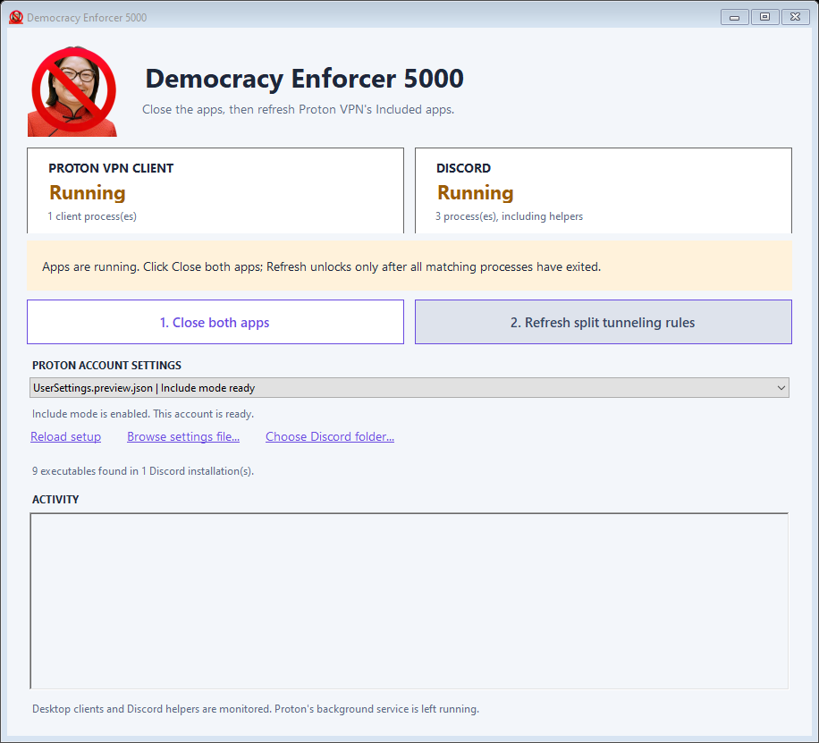

# Anti-Janjanator 5000

A portable Windows app that refreshes Discord executable paths in Proton VPN's
Split Tunneling **Included apps** after Discord updates.



The app monitors Discord and the Proton VPN desktop client. Use **Close both
apps**, then **Refresh split tunneling rules** once both have exited. Select
the intended account if more than one Proton account is saved on the PC.

- Finds Discord, PTB, and Canary installations and their helper executables.
- Blocks refresh while matching apps are running or their status is uncertain.
- Adds current executable paths and removes missing old Discord paths.
- Preserves unrelated Included apps and preferences, with an exact backup for
  every actual change.
- Leaves the apps closed; reopen Proton, reconnect, then open Discord.
- Includes the supplied artwork as the header, application icon, and tray icon.

Proton's background VPN service stays running. This unofficial utility was
checked against Proton VPN 5.1.9's settings layout; future versions may differ.
See the [user guide](docs/USER-GUIDE.md) for setup, backup restoration, and details.

## First launch

The first launch configures Proton VPN once per Windows user: start with Windows
and connect automatically; Fastest country excluding Brazil; Proton Protocols
enabled with Proton WireGuard; and Split tunneling enabled in Include mode,
subject to Proton's account/feature availability. Existing exclusions and
Included apps are preserved.

Choose an account if more than one is saved, and exit Proton from its tray icon.
Setup applies automatically once its exit is verified, then opens the same
updater interface. Reopen Proton afterward to apply the preferences and register
Windows startup. Discord can stay open during this setup step.

Successful setup is remembered outside the app folder. Future launches and
newly extracted app versions leave these preferences unchanged. Failed or
skipped setup remains pending for a later launch. See
[first-launch details](docs/FIRST-LAUNCH.md) for backups and limitations.

## Build and run

Requires 64-bit Windows, Windows PowerShell 5.1, and .NET Framework 4.x with its
C# compiler. No NuGet packages or external libraries are needed.

From Windows PowerShell in this repository:

```powershell
powershell.exe -NoProfile -ExecutionPolicy Bypass -File .\build.ps1
```

Open `dist\Anti-Janjanator-5000\Anti-Janjanator 5000.exe`. Keep the generated
folder together: the two PowerShell workers are needed at runtime. The build
also creates `dist\Anti-Janjanator-5000-v9.zip` for sharing. Builds are unsigned.

## Verify

```powershell
powershell.exe -NoProfile -ExecutionPolicy Bypass -File .\scripts\Test.ps1
```

This builds the app, runs first-launch, UI policy, and synthetic worker tests,
and renders the forms using example data. Tests do not close real Discord/Proton processes or
edit real account settings. Temporary fixtures and previews go in `artifacts/`.
See [validation notes](docs/VALIDATION.md) for the scope and limitations.

If a newly signed-in account has no saved split-tunneling settings yet, the app
now shows whether Split tunneling is off or still uses Exclude mode. Enable
Include mode in Proton, apply it, and exit Proton before refreshing. An omitted
Included-app list can be created by Refresh once Include mode is enabled. See
[troubleshooting](docs/TROUBLESHOOTING.md) for the former unsupported-format error
and uncertain process status.

## Repository layout

| Path | Purpose |
| --- | --- |
| `src/UpdaterWindow.cs` | Windows Forms interface and process inspection |
| `src/FirstLaunchSetup.cs` | One-time setup form, settings transaction, completion marker |
| `src/UpdaterWorker.ps1` | Separate close and refresh operations |
| `src/Update-DiscordRules.ps1` | Discovery, validation, and atomic settings updates |
| `assets/` | Embedded header PNG and multi-resolution ICO |
| `tests/` | Synthetic regression tests and fixture renderer |
| `build.ps1` | Compile and package the portable Windows app |

Do not commit account settings, backups, request/result records, or logs.
Generated builds and local test artifacts are excluded by `.gitignore`.
